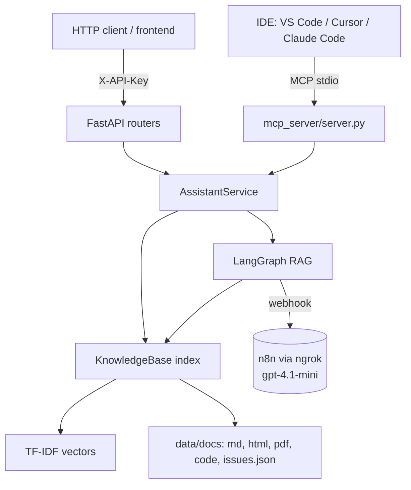

# Application Development Knowledge Assistant for IT Teams

Final assessment project #6 of the TCS AI Lab LLM course.

An AI-powered technical assistant that gives developers instant, **cited** answers from internal documentation: coding standards, API guidelines, runbooks, troubleshooting guides, approved code snippets and past issue tickets. It is exposed as a layered **FastAPI** backend and as an **MCP server**, so developers can use it straight from their IDE.

| Course lesson | Where it lives in this project |
|---|---|
| 1. FastAPI, layers, `Depends` auth | `app/routers`, `app/services`, `app/schemas`, `app/core/security.py` |
| 3. RAG: tiktoken, chunking, embeddings, cosine | `app/services/chunker.py`, `embeddings.py`, `knowledge_base.py` |
| 7. LangGraph agentic RAG | `app/services/rag_graph.py` |
| 8. MCP servers and clients | `mcp_server/server.py`, `mcp_server/client_demo.py` |

## LLM access: n8n webhook instead of an SDK

Like `services/kb_generator.py` in the Incident2KB reference project, the app does **not** call the model directly. It never uses the OpenAI SDK or `ChatOpenAI`, and it needs **no API key**. Every LLM call is a plain `requests.post` to an n8n webhook exposed through ngrok (`N8N_WEBHOOK_URL`). The model (gpt-4.1-mini) and its credentials live in the n8n workflow.

Request body sent by `app/services/llm_client.py`:

```json
{ "system": "<instructions for this step>", "prompt": "<question + documentation context>" }
```

Accepted responses are plain text, or JSON with `output`, `article`, `text`, `result`, `response` or `answer` (also a list of items, or an OpenAI `choices` body).

**The n8n workflow for this project** needs three nodes:

1. **Webhook** (POST).
2. **AI Agent / OpenAI Chat Model**, with system message `{{ $json.body.system }}` and user message `{{ $json.body.prompt }}`.
3. **Respond to Webhook**, returning `{"output": ...}` or the text.


This project raises `LLMWebhookError`, so the graph can **degrade gracefully** instead of showing an error string as if it were an answer.

Retrieval vectors are computed locally with TF-IDF (with light stemming), because the webhook does not provide an embeddings endpoint. Any class that follows the `Embedder` protocol, such as sentence-transformers, can be plugged in.

## Architecture



### Agentic RAG graph

```
START -> initialize -> retrieve -> grade_context --relevant--> generate_answer -> END
                          ^              |
                          |        weak & attempts left
                          |              v
                          +------ rewrite_question
                                         |
                                weak & no attempts left
                                         v
                                  fallback_answer -> END
```

- **grade_context** measures **cosine similarity** (best chunk must reach `SIMILARITY_THRESHOLD`, default `0.25`) and **keyword overlap** between the question (original + rewritten) and the retrieved text.
- **rewrite_question** asks the LLM, through the webhook, for a better English search query (so Spanish questions also work against English docs). If the webhook fails, it falls back to deterministic keyword expansion. It loops up to `max_attempts`.
- **generate_answer** requires `[doc_id]` citations. Only ids present in the retrieved context count; if the model omits them, the sources are appended and a warning is returned. If the LLM is down, it returns the top excerpts with citations (`status="degraded"`).
- **fallback_answer** returns `I don't know based on the provided documentation.` instead of hallucinating.

Response `status`: `answered` · `no_answer` (the model said the context is not enough) · `general` (hybrid mode: general-knowledge answer, queued for review) · `fallback` (weak retrieval) · `degraded` (LLM unavailable).

### Hybrid mode and review queue (Incident2KB-style)

With `HYBRID_MODE=true` (the default), when the documentation cannot answer a question (weak retrieval, or the model says the context does not contain the answer), the graph goes to `general_answer` instead of replying "I don't know":

1. The model answers from general engineering knowledge. The answer is labelled **"Not in the internal documentation"** and has **no citations**.
2. The answer is stored as a **pending draft** (`data/drafts/drafts.json`). If the question is similar to an existing pending draft, that draft's `asked_count` goes up instead, so the queue is also a ranked list of documentation gaps.
3. An **admin** reviews it in the UI (**Review** tab, visible only to the admin role): edits the title, `doc_id`, type, tags and Markdown content, then **approves** or **rejects** it.
4. Approving writes `data/docs/approved/<doc_id>.md` (with provenance in the frontmatter: source draft, question, reviewer, date) and rebuilds the index. From then on the question is answered **with citations**.

Generated content never reaches the knowledge base without human review. Set `HYBRID_MODE=false` for the strict behaviour required by the assessment brief.

## Project layout

```
app/
  core/        config.py (env settings), security.py (X-API-Key + roles)
  schemas/     assistant.py (Pydantic contracts)
  services/    llm_client.py (webhook), embeddings.py, document_loader.py,
               chunker.py, knowledge_base.py, rag_graph.py, assistant_service.py
  routers/     assistant.py, health.py
  main.py      connects the layers
mcp_server/    server.py (tools/resources/prompts), client_demo.py
data/docs/     synthetic knowledge base (standards, guides, runbooks, troubleshooting,
               snippets/*.py, issues/issue-tracking-log.json)
scripts/       check_webhook.py, ask.py
frontend/      developer chat UI (index.html, styles.css, app.js)
design-system/ UI UX Pro Max design tokens (MASTER.md)
tests/         42 offline tests (fake webhook)
```

## Quick start

```powershell
python -m venv .venv
.venv\Scripts\Activate.ps1
pip install -r requirements.txt

copy .env.example .env      # then set N8N_WEBHOOK_URL (full /webhook/<id> path)
python scripts\check_webhook.py
```

### Run the API and the developer UI

```powershell
uvicorn app.main:app --reload --port 8001
```

- **Chat UI:** http://127.0.0.1:8001/ (redirects to `/ui/`). Enter a key from `API_KEYS` in `.env` when it asks.
- **Swagger:** http://127.0.0.1:8001/docs. Click **Authorize** and use the same key.

Port 8001 avoids clashing with other local projects on 8000.

#### Developer UI

`frontend/` is a build-free HTML/CSS/JS app served by FastAPI at `/ui` on the same origin, so no CORS is needed. Its design system was generated with the **UI UX Pro Max** skill and saved in `design-system/dev-knowledge-assistant/MASTER.md`: Dark Mode (OLED), JetBrains Mono + IBM Plex Sans, and green "run" accent for a developer tool.

- **Ask the docs:** chat with answers rendered as Markdown (sanitized with DOMPurify), syntax-highlighted code with copy buttons, clickable `[doc_id]` citation chips, source cards with similarity scores, a status badge (`answered` / `fallback` / `degraded` / `no_answer`) and the collapsible **LangGraph trace**.
- **Find snippets:** code retrieval over approved snippets.
- **Sidebar:** search scope by document type, every document grouped by type (opens in a side drawer), and index/webhook status.
- **Accessibility:** visible labels, keyboard navigation (Enter to send, Esc to close), visible focus, 44px touch targets, `aria-live` answers, `prefers-reduced-motion`, and a responsive layout from 375px up.

| Method | Path | Role | Purpose |
|---|---|---|---|
| GET | `/health` | public | Status and index stats |
| POST | `/api/v1/assistant/ask` | developer | Agentic RAG answer with citations and trace |
| POST | `/api/v1/search` | developer | Semantic search, no generation |
| GET | `/api/v1/snippets/search?q=&language=` | developer | Code snippet retrieval |
| GET | `/api/v1/documents[?doc_type=]` | developer | List documents |
| GET | `/api/v1/documents/{doc_id}` | developer | Full document |
| POST | `/api/v1/admin/reindex` | admin | Reload `data/docs` without a restart |
| GET | `/api/v1/me` | any | Role of the current key |
| GET | `/api/v1/admin/drafts?status=pending` | admin | Review queue, most-asked first |
| PATCH | `/api/v1/admin/drafts/{id}` | admin | Edit a pending draft |
| POST | `/api/v1/admin/drafts/{id}/approve` | admin | Publish to `data/docs/approved/` and reindex |
| POST | `/api/v1/admin/drafts/{id}/reject` | admin | Reject with an optional note |

```powershell
curl -X POST http://127.0.0.1:8001/api/v1/assistant/ask `
  -H "X-API-Key: dev-key-change-me" -H "Content-Type: application/json" `
  -d '{\"question\": \"How do we handle database connection pool exhaustion?\"}'
```

### Ask from the terminal

```powershell
python scripts\ask.py "How should I retry calls to a flaky downstream API?"
python scripts\ask.py --graph      # Mermaid diagram of the LangGraph
```

### Use it from your IDE (MCP)

The MCP server exposes:

- **Tools:** `ask_dev_assistant`, `search_documentation`, `search_code_snippets`, `get_document`, `list_documents`
- **Resources:** `devkb://catalog`, `devkb://docs/{doc_id}`
- **Prompts:** `review_against_standards`, `troubleshoot_error`

The configuration is already included:

- **VS Code / Copilot agent mode:** `.vscode/mcp.json`
- **Claude Code:** `.mcp.json` (project scope)

Try it without an IDE:

```powershell
python mcp_server\client_demo.py
```

## Adding documentation

Drop files into `data/docs/` and call `POST /api/v1/admin/reindex` (or restart):

- **Markdown/TXT** with optional frontmatter: `doc_id`, `title`, `doc_type`, `language`, `tags`
- **HTML** with `<meta name="doc_id">`, `<meta name="doc_type">`; `<pre><code>` blocks are kept as code
- **PDF** (text layer required)
- **Code** (`.py .js .ts .java .cs .go .sql .sh .ps1 .yaml`) → `doc_type=snippet`; the docstring or header comment becomes the title
- **Issue logs**: a JSON list of `{key, summary, component, status, symptoms, root_cause, resolution, labels}`; each ticket becomes a citable document (`[dev-1042]`)

Chunks are measured in tiktoken tokens (`o200k_base`, the gpt-4.1 encoding), never mix sections, and never split a code block.

## Configuration

See `.env.example`. Key settings:

| Variable | Default | Notes |
|---|---|---|
| `N8N_WEBHOOK_URL` | - | `https://<tunnel>.ngrok-free.dev/webhook/<id>` |
| `N8N_WEBHOOK_TIMEOUT` | `120` | seconds (read timeout) |
| `SIMILARITY_THRESHOLD` | `0.25` | grade_context cut-off |
| `MAX_ATTEMPTS` | `2` | rewrite_question loops |
| `API_KEYS` | `dev-key...:developer,admin-key...:admin` | change these |

> With TF-IDF, scores are lower than with dense embeddings, so some questions go through `rewrite_question` before they are answered. That is expected, and it shows the loop working.

## Tests

```powershell
python -m pytest
```

The suite runs fully offline because the webhook is replaced by a fake LLM. It covers ingestion, chunking, every graph route (answer, rewrite with LLM/heuristic, fallback, missing citations, LLM outage), the webhook client (payload without auth, plain-text and JSON responses, HTTP errors, timeouts) and the API (auth, roles, validation, 404).
